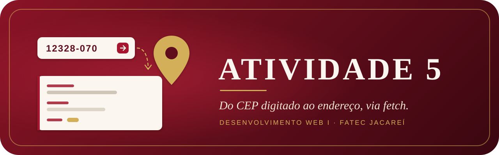
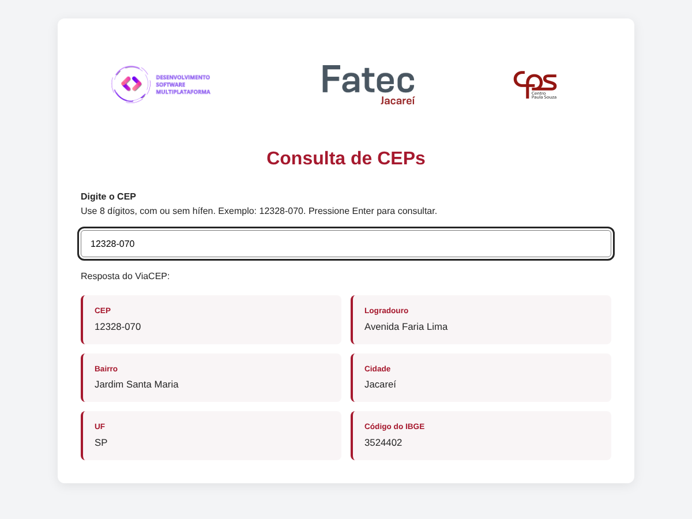
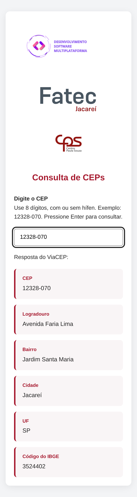
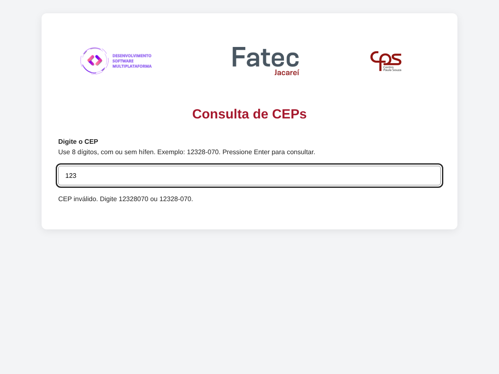
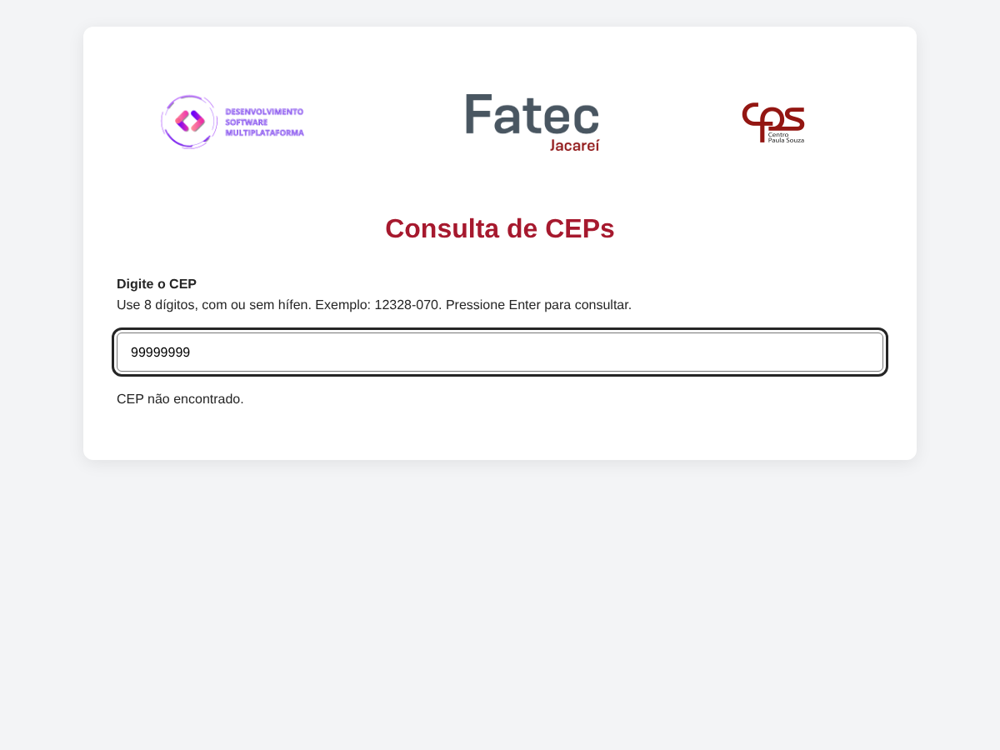
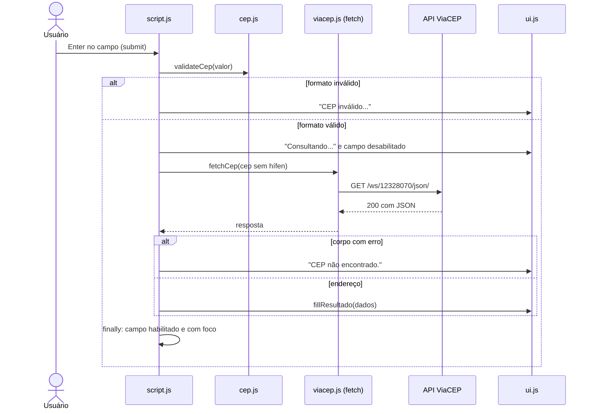

<div align="center">



**Consulta de CEP utilizando fetch.**


[Galeria](#-galeria) · [Como resolvi](#-como-resolvi-a-tarefa) · [Funcionalidades](#-funcionalidades) · [Arquitetura](#-arquitetura) · [Executar](#-executar) · [Estrutura](#-estrutura) · [Limitações](#-limitações-e-próximos-passos)

</div>

---

> [!NOTE]
> Esta é a **Atividade 5** da disciplina Desenvolvimento Web I (Prof. Arley), do curso de Desenvolvimento de Software
> Multiplataforma da Fatec Jacareí. A seção [Como resolvi a tarefa](#-como-resolvi-a-tarefa) descreve o caminho do
> enunciado até a entrega: o que foi pedido, o que analisei, o que decidi e como implementei e verifiquei.

Quem digita um CEP espera ver o endereço, e quando algo dá errado espera saber o quê: se errou a digitação, se o CEP não
existe ou se a conexão caiu. A página resolve isso no navegador, com um formulário de um campo que confere o formato antes
de gastar uma requisição, consulta a API pública do [ViaCEP](https://viacep.com.br/) e mostra logradouro, bairro, cidade,
UF e código do IBGE em cartões, ou uma mensagem própria para cada tipo de falha. O servidor Express só entrega a página e
os arquivos estáticos; toda a consulta acontece no cliente, em quatro módulos ES com 79 linhas no total.

## 📸 Galeria

<table align="center">
  <tr>
    <td align="center"><br><sub><b>CEP encontrado</b><br><code>12328-070</code></sub></td>
    <td align="center" rowspan="2"><br><sub><b>Celular, 390 px</b><br><code>12328-070</code></sub></td>
  </tr>
  <tr>
    <td align="center"><br><sub><b>Formato inválido, sem requisição</b><br><code>123</code></sub></td>
  </tr>
  <tr>
    <td align="center" colspan="2"><br><sub><b>CEP inexistente</b><br><code>99999999</code></sub></td>
  </tr>
</table>

<p align="center"><sub>Capturas reais da página rodando localmente. As respostas do ViaCEP exibidas são os corpos devolvidos pela API real para esses CEPs, reproduzidos no navegador de teste (detalhes em <a href="#5-como-verifiquei">Como verifiquei</a>).</sub></p>

---

## 🧭 Como resolvi a tarefa

### 1. O que a tarefa pedia

O enunciado pedia uma página servida por **Node.js com Express** que consultasse endereços por CEP fazendo uma
**requisição HTTP com `fetch`** à API do ViaCEP e exibisse o resultado na tela. Daí tirei quatro critérios de aceitação
para conferir no fim:

- o CEP é aceito com ou sem hífen, e um formato inválido é recusado sem chamar a API;
- um CEP válido gera exatamente uma requisição a `viacep.com.br/ws/{cep}/json/`;
- o endereço encontrado aparece na página, e cada tipo de falha tem uma mensagem própria;
- a página continua utilizável depois de qualquer resultado, inclusive de erro.

### 2. O que analisei

O primeiro ponto foi entender o contrato do ViaCEP, porque ele tem uma particularidade: um CEP **bem formado mas
inexistente** não devolve erro HTTP. A resposta de `/ws/99999999/json/` é `200` com o corpo `{"erro": "true"}`, e só um
CEP malformado recebe `400`. Isso significa que `resposta.ok` sozinho não basta; é preciso ler o JSON e procurar a
propriedade `erro`.

O segundo foi como o `fetch` sinaliza falhas. Ele só rejeita a promessa quando a requisição nem chega a ter resposta
(rede fora, DNS, CORS); um `404` ou `400` resolve normalmente com `ok` falso. Portanto há três caminhos de erro
distintos (rejeição, `ok` falso e `erro` no corpo), e cada um merece uma mensagem diferente para o usuário.

O terceiro foi onde validar. Validar no navegador antes do `fetch` evita uma ida à rede para um valor que certamente
falharia e permite uma mensagem que ensina o formato correto.

<details>
<summary><b>Alternativas avaliadas</b></summary>

| Abordagem | Como funciona | Avaliação |
|---|---|---|
| Consulta pelo servidor | Uma rota Express (`/api/cep/:cep`) chama o ViaCEP e repassa o JSON. | Permite cache e esconde a API externa, mas o enunciado pede o `fetch` no front e o ViaCEP já libera CORS. |
| `XMLHttpRequest` | API antiga de requisições baseada em eventos. | Funciona, mas é mais verbosa e não combina com `async/await`. |
| Consulta ao digitar | Dispara o `fetch` quando o campo chega a 8 dígitos. | Mais fluida, porém dispara requisições sem intenção explícita e complica o controle de corrida entre respostas. |
| **`fetch` no envio do formulário** | O `submit` valida, chama o ViaCEP e trata cada desfecho. | **Escolhida.** Atende ao enunciado, uma requisição por intenção do usuário e o Enter funciona de graça por ser um `<form>`. |

</details>

### 3. O que decidi

Decidi fazer a consulta no **envio do formulário**, com `fetch` e `async/await`, e separar o código em quatro módulos ES
com uma responsabilidade cada: validação (`cep.js`), requisição (`viacep.js`), tela (`ui.js`) e o fluxo que liga os três
(`script.js`). O fluxo trata os três caminhos de erro identificados na análise em ramos separados e usa `finally` para
devolver o campo ao usuário em qualquer desfecho. O servidor ficou propositalmente mínimo: estáticos em `/assets` e a
página para qualquer outro caminho.

### 4. Como implementei

| Passo | Arquivo | O que foi feito | Recurso usado |
|---|---|---|---|
| a | `package.json`, `.env.example` | Projeto Node em ES Modules com Express e a porta vinda do ambiente. | `"type": "module"`, `dotenv` |
| b | `src/server/paths.js` | Centralizei o caminho da pasta `public`, independente de onde o servidor é iniciado. | `import.meta.dirname` |
| c | `src/server/main.js` | Servi `/assets` como estático e a página para qualquer outra rota. | `express.static`, middleware final |
| d | `src/public/index.html` | Formulário com um campo, ajuda de formato, área de mensagem e seis cartões ocultos. | `novalidate`, `inputmode="numeric"`, `autocomplete="postal-code"`, `hidden` |
| e | `src/public/assets/js/cep.js` | Validação de 8 dígitos com hífen opcional e remoção do hífen. | Expressão regular `^\d{5}-?\d{3}$` |
| f | `src/public/assets/js/viacep.js` | Função que monta a URL e devolve a promessa do `fetch`. | `fetch`, template string |
| g | `src/public/assets/js/ui.js` | Escrita da mensagem e preenchimento dos cartões, com "Não informado" para campos vazios. | `textContent`, `\|\|` |
| h | `src/public/assets/js/script.js` | Fluxo do `submit`: valida, bloqueia o campo, consulta, trata erros e libera o campo. | `async/await`, `try/catch/finally` |
| i | `Dockerfile`, `compose.yaml` | Imagem de produção com usuário sem privilégios, publicada na porta 3002. | `node:24-alpine`, `npm ci --omit=dev`, `USER node` |

Três cuidados merecem destaque. No passo **h**, o campo fica desabilitado enquanto a requisição está em andamento, o que
impede um segundo Enter de disparar outra consulta, e o `finally` o reabilita e devolve o foco mesmo quando a resposta é
um erro. Ainda no passo **h**, o resultado anterior é ocultado logo no início do envio, de modo que um endereço antigo
nunca aparece ao lado da mensagem de uma consulta nova. No passo **g**, os valores entram por `textContent`, e não por
`innerHTML`, então nada que venha da API é interpretado como HTML.

### 5. Como verifiquei

Primeiro o servidor, com um laço em shell que pede a página, uma rota qualquer e os estáticos, conferindo o status e se
a resposta é a página do formulário:

```bash
for r in / /qualquer/rota /assets/css/index.css /assets/js/script.js; do
  code=$(curl -s -o /tmp/r -w "%{http_code}" "localhost:3001$r")
  echo "$r $code formulario=$(grep -c 'id="cep-form"' /tmp/r)"
done
```

| Rota | Status | Página do formulário |
|---|---|---|
| `/` | 200 | 1 |
| `/qualquer/rota` | 200 | 1 |
| `/assets/css/index.css` | 200 | 0 |
| `/assets/js/script.js` | 200 | 0 |

Como a consulta roda no navegador, o `curl` não alcança a parte principal. Para ela, escrevi
[`docs/verificacao/consulta.py`](docs/verificacao/consulta.py), que abre a página no Chrome com Playwright, digita cada
CEP, pressiona Enter e registra quantas requisições saíram, a mensagem exibida, se os cartões apareceram e se o campo
voltou a ficar habilitado. As chamadas ao ViaCEP são interceptadas e respondidas com os corpos que a API real devolveu
para `12328070` e `99999999`, o que torna reproduzíveis os casos de HTTP 400 e de queda de rede, impossíveis de provocar
sob demanda contra o serviço real.

```bash
python3 docs/verificacao/consulta.py http://localhost:3001
```

| Entrada | Requisições | Mensagem | Cartões | Campo habilitado |
|---|---|---|---|---|
| `12328-070` | 1 | Resposta do ViaCEP: | visíveis | sim |
| `12328070` | 1 | Resposta do ViaCEP: | visíveis | sim |
| `123` | 0 | CEP inválido. Digite 12328070 ou 12328-070. | ocultos | sim |
| `12a28-070` | 0 | CEP inválido. Digite 12328070 ou 12328-070. | ocultos | sim |
| `99999999` (inexistente) | 1 | CEP não encontrado. | ocultos | sim |
| `22222222` (API responde 400) | 1 | Erro ao consultar o ViaCEP. | ocultos | sim |
| `11111111` (rede abortada) | 1 | Falha de conexão. Tente novamente. | ocultos | sim |

Os dois formatos aceitos chegam ao mesmo endereço, os inválidos não geram nenhuma requisição, cada falha tem sua
mensagem e o campo volta utilizável em todos os casos, o que atende aos quatro critérios do passo 1. Também conferi o
layout em tela de computador e de celular (as capturas da [Galeria](#-galeria)).

---

## ✨ Funcionalidades

| | O que faz |
|---|---|
| **Validação antes da rede** | Aceita `12328070` ou `12328-070` e recusa qualquer outro formato sem chamar a API. |
| **Consulta com `fetch`** | Uma requisição a `https://viacep.com.br/ws/{cep}/json/` por envio do formulário. |
| **Quatro mensagens de erro** | Formato inválido, CEP inexistente, erro HTTP e falha de conexão têm textos distintos. |
| **Resultado em cartões** | CEP, logradouro, bairro, cidade, UF e código do IBGE; campos vazios aparecem como "Não informado". |
| **Sem envio duplicado** | O campo é desabilitado durante a consulta e reabilitado, com foco, ao final. |
| **Layout responsivo** | Cartões em duas colunas no computador e em uma coluna abaixo de 600 px. |
| **Teclado e acessibilidade** | Consulta pelo Enter, `inputmode="numeric"` para teclado numérico no celular e contorno de foco visível. |
| **Container pronto** | `docker compose up --build` sobe a imagem `node:24-alpine` rodando como usuário `node`. |

## 🧱 Arquitetura



O trecho central é o tratamento dos desfechos em `searchEndereco`, onde cada um dos três caminhos de erro da análise tem
o seu ramo:

```js
// src/public/assets/js/script.js
  try {
    const resposta = await fetchCep(cepLimpo);

    if (!resposta.ok) {
      showMensagem(textMensagem, "Erro ao consultar o ViaCEP.");
      return;
    }

    const dadosCep = await resposta.json();

    if (dadosCep.erro) {
      showMensagem(textMensagem, "CEP não encontrado.");
      return;
    }

    fillResultado(dadosCep);
    areaResultado.hidden = false;
    showMensagem(textMensagem, "Resposta do ViaCEP:");
  } catch {
    showMensagem(textMensagem, "Falha de conexão. Tente novamente.");
  } finally {
    inputCep.disabled = false;
    inputCep.focus();
  }
```

```js
// src/public/assets/js/cep.js
export function validateCep(cep) {
  return /^\d{5}-?\d{3}$/.test(cep);
}
```

O servidor tem 23 linhas. `paths.js` monta o caminho de `public` a partir de `import.meta.dirname`, recurso que pede
Node.js 20.11 ou superior.

## 📦 Executar

Requisitos: Node.js 20.11 ou superior e npm, ou Docker com Compose. A consulta precisa de acesso à internet para
alcançar o ViaCEP.

```bash
git clone https://github.com/Pedrojscx/atividade-005-desenvolvimento-web-fatec.git
cd atividade-005-desenvolvimento-web-fatec
npm install
[ -f .env ] || cp .env.example .env   # cria o .env só se ele ainda não existir
npm start                             # ou: npm run dev, que reinicia ao salvar
```

Abra `http://localhost:3001` (a porta definida em `PORT` no `.env`).

Para rodar em container:

```bash
docker compose up --build   # acesse http://localhost:3002
docker compose down         # para e remove o container
```

> [!TIP]
> Teste `12328-070`, o CEP do exemplo da página, e depois `99999999` para ver a mensagem de CEP inexistente.

## 📁 Estrutura

```txt
atividade-005-desenvolvimento-web-fatec/
├── package.json
├── .env.example               # PORT=3001
├── Dockerfile                 # node:24-alpine, usuário node, porta 3000
├── compose.yaml               # publica 3000 do container em 3002
├── docs/
│   ├── assets/                # banner deste README
│   ├── screenshots/           # capturas da galeria
│   └── verificacao/
│       └── consulta.py        # cenários da consulta no navegador
└── src/
    ├── server/
    │   ├── main.js            # Express: /assets estático e página para o resto
    │   └── paths.js           # caminho de public/
    └── public/
        ├── index.html         # formulário, mensagem e cartões
        └── assets/
            ├── css/index.css
            ├── images/        # logos do DSM, da Fatec e do CPS
            └── js/
                ├── script.js  # fluxo da consulta (ponto de entrada)
                ├── cep.js     # validação e formatação
                ├── viacep.js  # requisição ao ViaCEP
                └── ui.js      # mensagem e cartões
```

## 🔭 Limitações e próximos passos

A entrega cumpre o que a atividade pede, e estes são os pontos que mudariam numa versão para produção:

- **Asset inexistente devolve a página.** Como o middleware final responde a qualquer caminho, `/assets/js/nada.js`
  retorna `200` com o HTML do formulário em vez de `404`. Montar o `express.static` com `fallthrough: false` resolveria.
- **Sem tempo limite.** Se o ViaCEP demorar a responder, a página fica em "Consultando..." indefinidamente. Passar
  `signal: AbortSignal.timeout(8000)` ao `fetch` levaria esse caso para a mensagem de falha de conexão.
- **Sem máscara no campo.** O formato só é conferido no envio; uma máscara que insere o hífen e limita a 8 dígitos
  durante a digitação evitaria boa parte dos erros.
- **Mensagens não anunciadas.** O `#mensagem` não tem `aria-live`, então leitores de tela não avisam quando o resultado
  chega. Um `aria-live="polite"` resolve.
- **Versão de Node desalinhada.** `engines` exige Node 24, mas o código só depende de recursos do 20.11 (e foi
  verificado no 22). Ajustar `engines` para `>=20.11` evita o aviso `EBADENGINE` em quem usa uma LTS anterior.
- **Sem testes automatizados.** `consulta.py` é executado manualmente; os mesmos cenários caberiam no `@playwright/test`
  e rodariam a cada push numa action do GitHub.

## 🎓 Contexto acadêmico

| | |
|---|---|
| **Instituição** | Fatec Jacareí, Centro Paula Souza |
| **Curso** | Desenvolvimento de Software Multiplataforma (DSM) |
| **Disciplina** | Desenvolvimento Web I |
| **Professor** | Arley |
| **Atividade** | 5, requisição HTTP com ViaCEP |

Os logos do DSM, da Fatec e do Centro Paula Souza pertencem às respectivas instituições e aparecem aqui apenas para
reproduzir a identidade do curso no exercício. Os dados de endereço vêm do [ViaCEP](https://viacep.com.br/).

---

<div align="center">
<sub>Atividade 5 · Desenvolvimento Web I · Pedro Lucas · 2026</sub>
</div>
